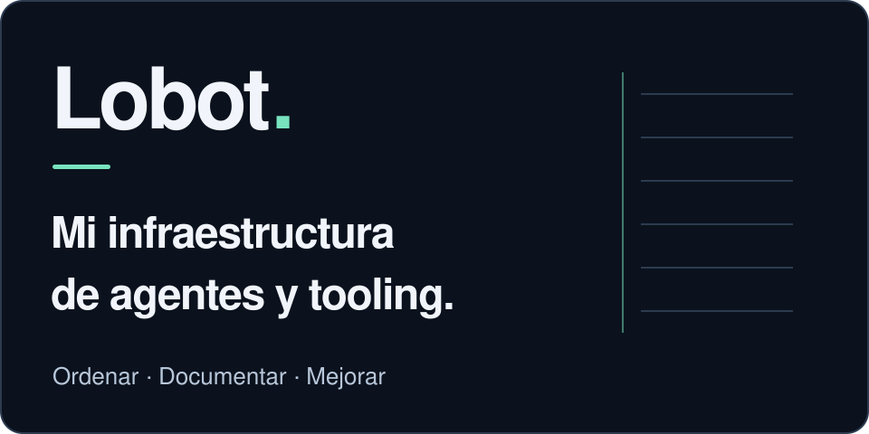
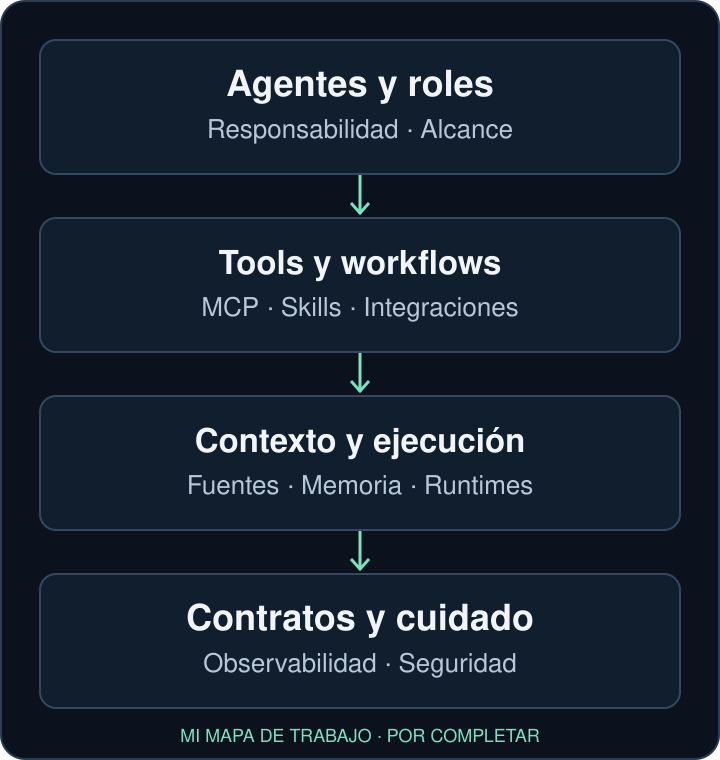

# Lobot

**Mi infraestructura de agentes y tooling.**

Acá reúno código y documentación del sistema que uso detrás de mis agentes: puentes entre canales, herramientas MCP, ejecución, contexto y formas de trabajar.

Lo mantengo para entender qué hace cada pieza, mejorarla y poder cambiarla sin perder lo que ya funciona. Comparto lo que pueda servirle a alguien más, con sus límites a la vista.

## Qué contiene este repo

- `src/bridge` y `src/cli`: el puente con el ejecutor local, su cola y las herramientas para consultar o encargar trabajo.
- `src/mcp` y `src/personal-os`: conectores e interfaces acotadas con Personal OS, que conserva sus datos y reglas de dominio.
- `src/personal` y `src/cron`: collectors y mecanismos de revisión o avisos que forman parte de la historia de la instalación.
- `docs`, scripts y `seed-workspace`: arquitectura, guías y bases de configuración del host. Algunas guías describen etapas anteriores; no son instrucciones para activar hoy esos mecanismos.

Uso Dot para coordinación y seguimiento según las capacidades probadas de cada flujo. El host conserva la cola durable y el único ejecutor de cada asunto; Lobot aporta los puentes y el respaldo local. Esa relación no significa que Dot conecte automáticamente todas las piezas de este repo.

Investigación, desarrollo, borradores y un Secretario son aplicaciones de esta infraestructura. WhatsApp es uno de sus canales.

## Estado del código y de la instalación

El código publicado y mi instalación personal no son lo mismo. El árbol conserva componentes del host y mecanismos históricos; su presencia no prueba que estén activos. Tampoco una prueba offline acredita una integración en producción.

En la instalación se documentaron recorridos reales y acotados entre Dot, Personal OS y el ejecutor existente, incluida lectura de avisos y acuse de evaluación con reintento sobre un aviso técnico propio, sin envío humano. Parte de esas mejoras todavía no está consolidada en este `main`: no presento esa evidencia como una funcionalidad lista para usar al clonar.

También hay un kit offline preparado por separado para adaptadores de Dot, WhatsApp, OpenClaw y Codex. Su bootstrap e imports aislados se verificaron con Node 24; necesita integrarse con el host y **no está incluido en esta entrega de portada**.

## Lo que sigue en su lugar de origen

Las skills externas conservan sus scripts y referencias donde están instaladas. Captura y HomeOps tienen sus propios proyectos y responsabilidades; acá interesa su relación con los agentes, sin dar por hechas integraciones.

Remote Station también forma parte del mapa: la Mac conserva UI, repos canónicos y tareas macOS; la estación privada sirve para builds, tests y backends Linux según el contrato de cada proyecto. Su implementación sigue en la skill local `remote-station`; no se migró a Lobot.

## Portabilidad y próximos pasos

Clonar este repo no instala toda mi infraestructura. Para reutilizar una pieza hay que revisar su contrato, dependencias, rutas y configuración. No ofrezco un instalador general ni una receta que conecte cuentas o active servicios.

Las credenciales, cuentas y configuración real deben quedar fuera de los ejemplos distribuibles. Esta actualización de portada no certifica que la historia completa sea apta para exposición pública: su revisión y saneamiento son un paso separado.

Sigo consolidando el inventario, los contratos y la evidencia de cada componente. Una capacidad inventariada, un experimento terminado y un aviso no son automáticamente trabajo pendiente. Conservo lo aprendido y continúo lo autorizado con su dueño, sin duplicar backlogs ni sumar otro supervisor.

Código bajo [licencia MIT](LICENSE), conservando la atribución existente.
