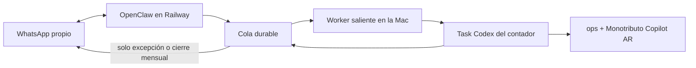

# Contador autónomo por excepción — spec

## Dolor

Matías ya puede usar Codex para facturar y revisar su situación fiscal, pero no
quiere reemplazar al contador por otra interfaz que tenga que conducir paso a
paso. Necesita que el sistema trabaje solo, conserve contexto y lo contacte
únicamente ante una decisión, un riesgo o una aprobación concreta.

## Solución MVP

Usar al Secretario Personal de OpenClaw como mesa de entrada y canal siempre
disponible, sin mover la lógica fiscal ni las credenciales a Railway:

1. **OpenClaw/Railway** es dueño del calendario y de la checklist fiscal:
   inicia todos los controles y seguimientos sin esperar un mensaje de Matías.
   El WhatsApp entrante queda como interfaz opcional, no como disparador
   necesario para que el sistema trabaje.
2. **La cola durable del puente** encola un trabajo idempotente para el task de
   Codex `Investigar reemplazo del contador`.
3. **El worker de la Mac** reanuda ese task con su contexto real y ejecuta las
   herramientas fiscales locales en `ops` y `monotributo-copilot-ar`.
4. **El puente devuelve a WhatsApp** solo resultados accionables. La respuesta
   exacta `DONT_NOTIFY` se registra, pero no se envía.
5. **Matías aprueba desde WhatsApp** una acción acotada; Codex vuelve a validar
   estado y evidencia antes de ejecutarla.

OpenClaw es el secretario y orquestador. Codex es el especialista fiscal. Los
artefactos locales son la fuente de verdad; el chat no lo es.

## Loop operativo autónomo

En cada corrida, el secretario determina por fecha y estado persistido qué
corresponde hacer, dispara el trabajo especializado y verifica el resultado. No
espera que Matías pregunte “qué hay que hacer”.

El sistema puede, sin intervención:

- leer y conciliar las fuentes autorizadas;
- actualizar registros, checklists y expedientes locales;
- generar reportes, dry-runs y borradores;
- verificar vencimientos, pagos aplicados, deuda y límites de categoría;
- reintentar una fuente temporalmente caída sin duplicar acciones;
- cerrar silenciosamente un control sano;
- escalar antes del vencimiento si una aprobación sigue pendiente.

Matías aparece en el loop únicamente cuando existe una acción irreversible, una
decisión con criterio personal o un caso extraordinario que requiere un
profesional. Las aprobaciones rutinarias se agrupan para no convertirlo en
operador del sistema.



## Cadencias

### Monitoreo fiscal

- Días hábiles a las 09:00 y 17:00.
- Revisa alertas DFE permitidas, frescura de fuentes y cambios materiales.
- No envía nada cuando el resultado es `DONT_NOTIFY`.

### Facturación

- Día 1 de cada mes a las 09:00 ART.
- Concilia Gmail, pagos, clientes y comprobantes existentes.
- Genera dry-runs y una única bandeja de aprobación por lote.
- Emisión y envío son dos aprobaciones distintas.

### Pago y tranquilidad mensual

- Días 18, 21 y 23: controla vencimiento y aplicación del pago.
- Día 23: envía una única confirmación mensual si las fuentes están frescas,
  el pago está aplicado y no hay pendientes.

### Pedido manual opcional

Desde el WhatsApp propio, frases como `contador estado`, `contador facturas` o
`contador revisá esta alerta` encolan un trabajo para el mismo task. Un selector
ambiguo nunca dispara trabajo. Este acceso sirve para consultas excepcionales;
ningún control periódico depende de que Matías lo use.

## Contrato de notificaciones

- **Canal:** WhatsApp personal, cuenta OpenClaw `default`.
- **Audiencia:** exclusivamente Matías mediante `WHATSAPP_PERSONAL_TARGET`.
- **Frecuencia máxima automática:** controles silenciosos dos veces por día
  hábil; un paquete mensual de facturación; una confirmación mensual; alertas
  adicionales solo ante una novedad P0/P1 deduplicada.
- **Variables permitidas:** estado, hecho verificable, evidencia no secreta,
  importe fiscal necesario, fecha límite, recomendación, identificador del job
  y acción exacta solicitada.
- **Prohibido incluir:** Clave Fiscal, tokens, claves privadas, certificados,
  datos bancarios completos, cuerpos de mensajes DFE o datos de terceros que no
  sean necesarios para la decisión.

Plantilla de excepción:

```text
🧾 Contador · {estado}
Qué pasó: {resumen}
Evidencia: {fuente_y_fecha}
Vence: {fecha_o_no_aplica}
Recomiendo: {siguiente_paso}
Necesito de vos: {aprobacion_exacta_o_nada}
Job: {job_id}
```

Plantilla de cierre saludable:

```text
✅ Contador · mes en orden
Pago aplicado, fuentes al día y sin avisos fiscales accionables.
Próximo control: {fecha}
```

## Aprobaciones y límites

El scheduler y el pedido manual pueden leer fuentes, reconciliar, actualizar
artefactos locales y preparar dry-runs. No pueden por sí solos:

- emitir un comprobante productivo;
- enviar un email o WhatsApp a terceros;
- generar o pagar un VEP;
- reasignar créditos;
- presentar una recategorización;
- responder una comunicación DFE.

Una aprobación debe identificar el job y la acción exacta. Antes de ejecutar,
Codex vuelve a comprobar que el estado no cambió. Las confirmaciones exigidas
por `monotributo-copilot-ar` siguen siendo obligatorias y nunca se agrega
`--force`.

Los casos extraordinarios se escalan a un profesional puntual; no reactivan un
abono mensual por defecto.

## Estado e idempotencia

- Cada corrida programada usa una clave estable por tipo, fecha y período.
- Railway conserva estado de cola, intentos y entrega.
- `ops/cobranzas/out/fiscal/monitoring-state.json` conserva el último estado
  fiscal notificado.
- Un resultado `DONT_NOTIFY` queda completado y marcado como no entregable.
- Si la Mac está fuera de línea, el job espera en la cola; no se duplica al
  recuperarse el worker.

## Migración sin doble ejecución

1. Agregar un dispatcher fiscal al Secretario Personal.
2. Agregar política de respuesta `actionable-only` al bridge y cubrirla con
   tests.
3. Agregar un endpoint idempotente para instalar/actualizar los cron fiscales
   de OpenClaw.
4. Probar end-to-end con una corrida read-only y entrega al WhatsApp propio.
5. Solo después del gate productivo, pausar las automatizaciones equivalentes
   de Codex para que OpenClaw quede como único scheduler.

## Criterios de aceptación

- El secretario puede disparar el task fiscal exacto sin exponer Codex App
  Server ni credenciales locales.
- El calendario fiscal completo se ejecuta sin que Matías envíe mensajes ni
  abra Codex.
- Un control sano no genera ningún WhatsApp.
- Una excepción genera una sola ficha y no se repite sin cambio de estado.
- El día 1 llega una única bandeja de facturas, no una conversación por cliente.
- Una respuesta de Matías reanuda el mismo task y conserva el expediente.
- Ninguna acción irreversible se ejecuta sin la confirmación específica
  requerida.
- La caída temporal de la Mac no pierde ni duplica jobs.
- Al activar OpenClaw como scheduler, no quedan cron equivalentes activos en
  paralelo.

## Fuera de alcance del MVP

- Guardar Clave Fiscal o certificados en Railway.
- Abrir el portal ARCA de forma desatendida.
- Pagar, presentar o responder automáticamente.
- Escribir a clientes, al contador u otros terceros desde el canal personal.
