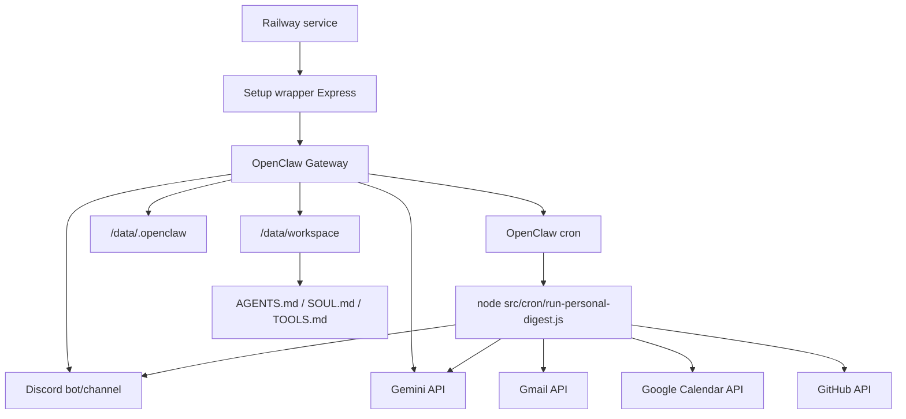

# Clawbot Personal — arquitectura base

## Objetivo

Plantar la base de un secretario personal que corre OpenClaw en Railway y avisa por Discord. El agente debe revisar señales personales, resumirlas, priorizarlas y proponer acciones sin mezclar automatizaciones laborales de Mango.

## Decisiones

- **Runtime obligatorio**: OpenClaw en Railway.
- **Modelo inicial**: Gemini vía API key, buscando mantenerse en free tier.
- **Canal de salida**: Discord, idealmente un servidor/canal privado `asistente-personal`.
- **Cadencia**: tres digests diarios en Buenos Aires (mañana/tarde/noche) + alertas reactivas P0/P1.
- **Persistencia**: Railway Volume montado en `/data`.
- **Configuración estable del agente**: workspace seed con `AGENTS.md`, `SOUL.md`, `TOOLS.md` y prompts.

## Componentes

## Fuentes personales iniciales

- Gmail, Calendar y Drive de `usuario@example.com`.
- GitHub del usuario `MatiasJRB`.
- Repos locales de contexto: `ops` y `gastos-automaticos`.
- Collectors API read-only para Gmail/GitHub y Calendar con write opcional para eventos confirmados con credenciales explícitas.

## Lo que esta base ya deja listo

- Imagen Docker actualizada a Node 24, alineada con el runtime recomendado por OpenClaw.
- Variables Railway alineadas con docs oficiales (`OPENCLAW_GATEWAY_PORT`, `/data`, token de gateway).
- Setup wizard capaz de usar `GEMINI_API_KEY` y `DISCORD_BOT_TOKEN` desde variables de entorno sin pegarlas en la UI.
- SecretRef para Discord cuando el token está en env.
- Redacción de secretos en output/logs del setup wrapper.
- Workspace inicial no destructivo: si `/data/workspace` ya tiene archivos, no los pisa.
- Scripts para instalar/editar cron digests como command cron jobs:
  OpenClaw ejecuta `node src/cron/run-personal-digest.js` en el Gateway,
  captura stdout y lo entrega al canal Discord configurado.
- Collectors:
  - Gmail: mensajes recientes por metadata/snippet, clasificados por seguridad,
    plata/pagos/vencimientos y posible respuesta.
  - Calendar: agenda próxima, cancelaciones recientes y conflictos.
  - GitHub: notificaciones, review requests, asignaciones/menciones y CI fallida
    en repos personales.

## Siguientes integraciones

1. Crear/confirmar Discord app + bot + canal privado.
2. Deploy Railway con Volume `/data` y variables.
3. Completar onboarding en `/setup`.
4. Instalar cron digests con `scripts/install-personal-crons.sh`.
5. Agregar credenciales personales:
   - GitHub: `GITHUB_TOKEN` read-only para notificaciones/issues/PRs/Actions.
   - Gmail/Calendar: OAuth con cuenta `usuario@example.com` (Calendar puede usar `calendar.events` para eventos confirmados).
   - Ops/gastos: jobs que lean inventarios/ICS/mails relevantes.
