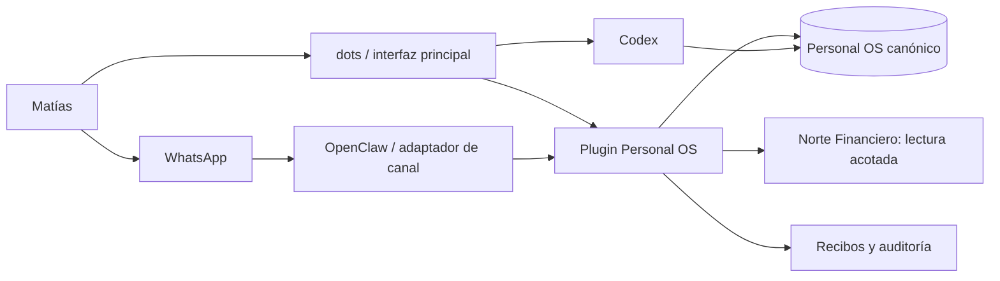

# Secretario Personal híbrido: dots + Personal OS + OpenClaw

**Estado:** arquitectura adoptada; lectura real desde dots operativa  
**Fecha:** 2026-09-29  
**Principio:** comprar/adoptar el runtime genérico; construir sólo la información, las reglas y las integraciones que son propias de Matías.

## Decisión

No continuar con una implementación completamente custom del secretario.

La arquitectura objetivo es híbrida:

- **OpenAI dots**: conversación principal, coordinación persistente, proactividad, tareas de fondo, horarios, aprobaciones y delegación a Codex.
- **Personal OS**: fuente canónica y portable para personas, asuntos, compromisos, plazos, decisiones, evidencia y estado.
- **Codex**: ejecución local y técnica sobre repos, archivos y aplicaciones autorizadas.
- **OpenClaw/Lobot**: borde de WhatsApp mientras dots no ofrezca un canal equivalente; deja de ser el cerebro y pasa a ser un adaptador.
- **Norte Financiero y otros sistemas**: dueños de sus datos de dominio; se exponen mediante herramientas acotadas y auditables, no copiando toda la base a la memoria del agente.

## Por qué

dots ya resuelve buena parte de lo costoso y genérico: agente siempre activo, memoria propia, trabajos paralelos, tareas recurrentes y por eventos, computadora cloud, plugins, permisos y delegación a Codex. Rehacer esas piezas sería caro, frágil y difícil de asegurar.

Pero dots no debe convertirse en la única base de conocimiento:

- el despliegue es gradual y el acceso puede variar por cuenta, región o plan;
- hoy documenta ChatGPT, Slack y Teams; el texting todavía figura como “coming soon” y no hay WhatsApp documentado;
- sus notas persistentes no son un registro estructurado completo ni reemplazan IDs, deduplicación, recibos y auditoría;
- la información personal debe poder sobrevivir a un cambio de proveedor o de interfaz.

## Arquitectura objetivo

## Límites de responsabilidad

### dots sí hace

- conversa y mantiene continuidad;
- decide cuándo seguir, despertar o pedir una decisión;
- coordina trabajo en background;
- ejecuta horarios y monitores;
- usa plugins y delega trabajo a Codex;
- aplica permisos y aprobaciones de plataforma.

### Personal OS sí hace

- conserva la verdad canónica y exportable;
- asigna identidad exacta y evita duplicados;
- registra estado, próximo paso, dueño, plazo y próxima revisión;
- mantiene decisiones, evidencia y recibos;
- ofrece consultas y mutaciones con contratos explícitos.

### OpenClaw sí hace

- recibe y entrega WhatsApp;
- traduce mensajes al contrato del Personal OS;
- devuelve respuestas y alertas por el canal elegido;
- no mantiene una memoria paralela ni decide la verdad del sistema.

## Roadmap con gates

### Fase 0 — Validación de dots (1 sesión)

Objetivo: comprobar que la cuenta de Matías tiene acceso real y que las capacidades necesarias funcionan.

- [x] Ver si aparece **dots** en ChatGPT web o desktop.
- [x] Crear un dot de prueba sin ampliar permisos de Google ni conectar la computadora local.
- [x] Configurar el dot **Secretario** con reglas estables y confirmación para acciones sensibles.
- [x] Confirmar que esta cuenta admite un plugin MCP propio mediante Secure MCP Tunnel.
- [ ] Confirmar acceso desde ChatGPT y, si está disponible, móvil.
- [ ] Probar una tarea de fondo, una tarea programada y una delegación a Codex.
- [ ] Revisar Activity, Scheduled, permisos, reglas y comportamiento al pausar/borrar.
- [x] Confirmar plugins disponibles; WhatsApp directo sigue fuera del alcance comprobado.

**Gate 0:** si dots no está habilitado o falla una capacidad esencial, OpenClaw sigue como orquestador temporal. Nada del trabajo siguiente se pierde.

**Comprobación 2026-09-29:** la cuenta real tiene acceso, el dot **Secretario** quedó creado y el plugin **Personal OS** se instaló sin conceder acceso amplio a Google ni a la Mac. La conexión local usa un túnel saliente privado y cuatro herramientas acotadas de sólo lectura.

### Fase 1 — Contrato portable del Personal OS (1–2 sesiones)

Objetivo: desacoplar los datos del agente que los consume.

- [ ] Definir entidades mínimas: asunto, compromiso, persona, decisión, evento, evidencia y aviso.
- [ ] Definir IDs estables, deduplicación, estados y recibos.
- [ ] Separar herramientas de lectura, captura y acción.
- [ ] Definir niveles: autónomo, confirmar antes, sólo proponer y prohibido.
- [ ] Asegurar que “no pude consultar” nunca se convierta en “no existe”.

**Gate 1:** el mismo contrato debe poder ser usado por dots, Codex y OpenClaw.

### Fase 2 — Plugin/adaptador Personal OS (2–4 sesiones)

Objetivo: que dots y Codex accedan a la misma verdad sin acceso bruto a la base.

Herramientas iniciales:

- [x] `personal_os_search` — busca por texto y devuelve IDs exactos.
- [x] `personal_os_get_card` — lee una ficha por ID exacto.
- [x] `personal_os_executive_inbox` — devuelve la bandeja ejecutiva vigente.
- [x] `personal_os_read_note` — lee sólo notas admitidas para el Secretario.
- `commitment_capture` — captura idempotente desde cualquier canal.
- `commitment_update` — propone o aplica una transición según permisos.
- `notice_submit` — recibe avisos de otros agentes sin cortar el chat.
- `norte_lookup` — consulta financiera read-only por ID o criterio explícito.

Toda mutación debe devolver un recibo durable; toda acción externa sensible requiere confirmación.

**Gate 2:** cero duplicados, cero acciones sin permiso y trazabilidad completa en una batería de casos conocidos.

**Subgate read-only comprobado 2026-09-29:** el dot consultó `personal_os_search("viajes")` y recuperó `moving_home_search` y `visa_b1b2`; también leyó ambas fichas exactas en paralelo. La falsa respuesta anterior de “no hay viajes” quedó corregida. El servidor de túnel tolera el sondeo `server/discover` y los dos `initialize` que hoy emite ChatGPT sobre el mismo proceso stdio. El Gate 2 completo sigue pendiente porque todavía no se expusieron mutaciones.

### Fase 3 — Piloto real en paralelo (7 días)

Objetivo: comparar operación real, no demos.

- [ ] Elegir un asunto personal activo con plazo y seguimiento.
- [ ] Operarlo desde dots usando Personal OS.
- [ ] Mantener WhatsApp/OpenClaw como canal paralelo y fallback.
- [ ] Medir exactitud de recuperación, seguimientos, interrupciones, duplicados y trabajo manual.
- [ ] Probar recuperación ante caída de dots, de la Mac y de OpenClaw.

**Gate 3:** dots pasa a interfaz primaria sólo si mantiene continuidad y supera al flujo actual sin perder WhatsApp ni trazabilidad.

### Fase 4 — Simplificación (1–2 sesiones)

Según el piloto:

- **dots-primary:** retirar del custom la memoria, planificación y scheduling duplicados; conservar OpenClaw como adaptador WhatsApp.
- **OpenClaw-primary temporal:** mantener la interfaz actual y reutilizar el plugin/contrato hasta que dots esté disponible o maduro.
- **híbrido permanente:** dots para coordinación y OpenClaw para WhatsApp, ambos sobre Personal OS.

Nunca migrar la fuente canónica a notas internas de un proveedor.

## Métricas de aceptación

| Métrica | Umbral |
|---|---:|
| Recuperación de 10 hechos conocidos | 10/10 |
| Falsos “no hay registro” ante error de acceso | 0 |
| Duplicados de compromisos | 0 |
| Acciones externas sin aprobación requerida | 0 |
| Mutaciones con recibo durable | 100% |
| Seguimientos correctos del piloto | ≥ 90% |
| Interrupciones innecesarias | Menos que el flujo actual |

## Qué no construir ahora

- otra memoria conversacional general;
- otro motor genérico de agentes en background;
- otra UI de chat;
- otro scheduler genérico;
- conectores ya cubiertos de forma segura por plugins de plataforma;
- migración masiva de datos antes del piloto.

## Próximo movimiento

Usar `visa_b1b2` como primer asunto del piloto read-only, verificar continuidad durante varios días y completar las pruebas pendientes de Fase 0. Después agregar captura y actualización con recibos durables y confirmación explícita; no ampliar permisos mientras la lectura no sea estable.

## Operación actual

- Plugin en ChatGPT: **Personal OS**.
- Túnel privado: **Secretario Personal OS**.
- Runtime local administrado: `secretario-personal-os`.
- Transporte de producción: stdio compatible con el ciclo legado de ChatGPT; no publica ningún puerto local.
- Restricción inevitable: si esta Mac o el runtime están apagados, el dot debe declarar que no pudo consultar. Nunca debe traducir esa caída como “no hay registros”.
