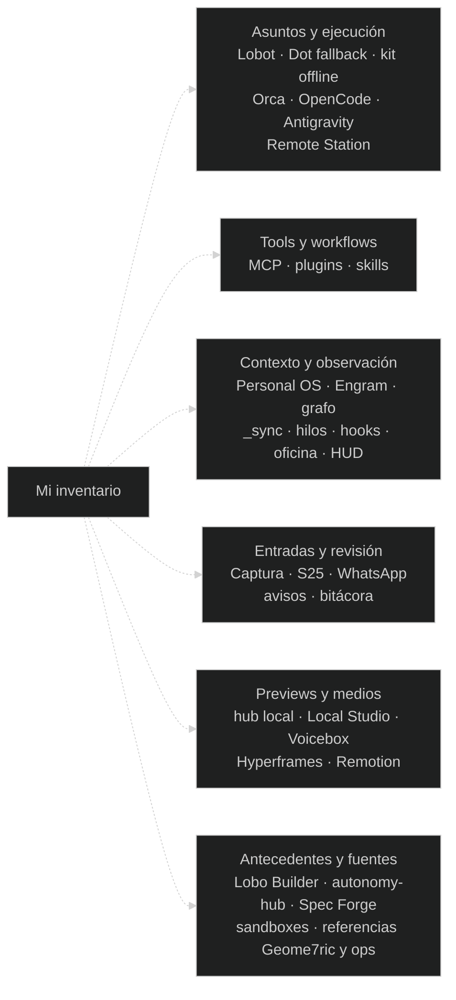
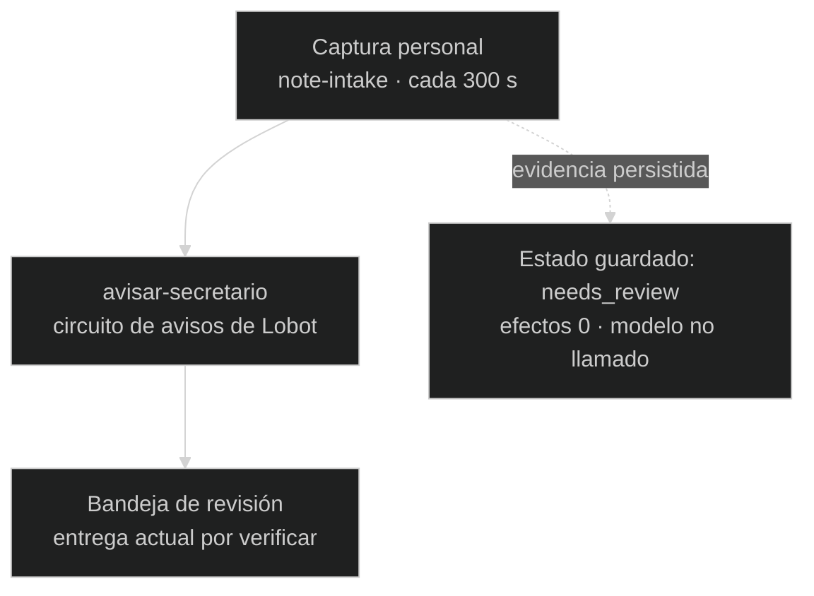

# Mi infraestructura, por funciones

Este árbol me ayuda a ubicar las piezas que estoy documentando. Las ramas
discontinuas significan **inventario**, no conexiones operativas de Lobot.
Incluye instalaciones externas y antecedentes; el detalle de origen y estado
queda en el [mapa completo](MAPA_INFRAESTRUCTURA.md).

La presencia de una app, repo, proceso o configuración tiene distinto peso que
una prueba de punta a punta. Uso esas diferencias en el
[registro de evidencia](INVENTARIO_EVIDENCIA.md); el árbol no indica que todo esté
activo, migrado o conectado.

## Una relación implementada: Captura personal y revisión

Las flechas continuas de este segundo dibujo representan el recorrido privado
implementado/configurado. No equivalen a una entrega actual verificada.

El estado guardado no tiene fecha confiable en los campos revisados. La relación
privada existe; el repo público de Captura sigue separado, sin adaptador genérico
incorporado a Lobot. La evidencia capturada no autoriza tareas por su contenido.

[Detalle de Captura y del resto del mapa](MAPA_INFRAESTRUCTURA.md) · [Qué compartir](COMPARTIR_LOBOT.md)
